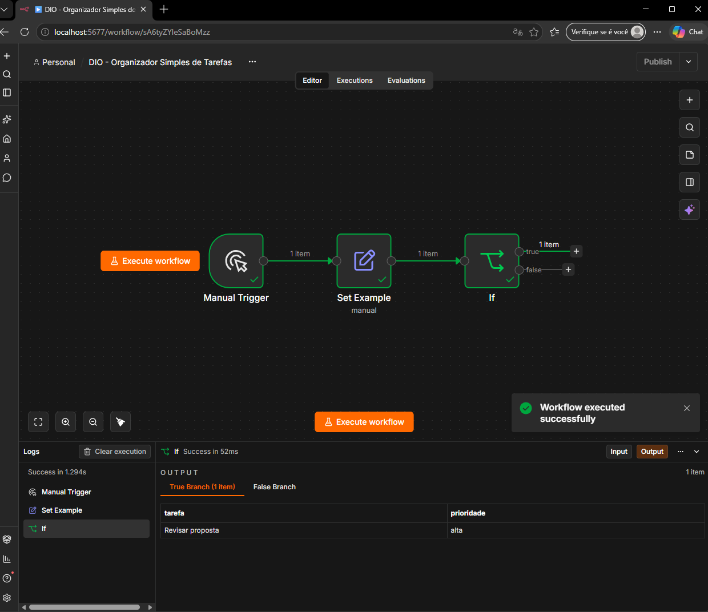

# DIO - Simple Task Organizer (n8n)

This project was developed as part of the DIO challenge **"Planning Automations with n8n Using Only Good Prompts."**

## Objective

Build a simple n8n automation that receives a sample task, checks its priority, and routes it to the appropriate output: **urgent** (high priority) or **normal** (all other priorities).

## Technologies used

- **n8n** — to build and execute the automation workflow.
- **Docker** — to run n8n locally.
- **OpenCode** — AI coding assistant used to plan and configure the workflow through prompts.

## Workflow nodes

The automation consists of three nodes:

1. **Manual Trigger** — starts the workflow manually with a single click.
2. **Set Example** — creates a sample task with the following fields:
   - `tarefa` = `"Revisar proposta"`
   - `prioridade` = `"alta"`
3. **IF** — checks whether the task priority is equal to `"alta"`:
   - **TRUE** → high priority (urgent).
   - **FALSE** → other priorities (normal).

## How it works

**Manual Trigger → Set Example → IF**

The workflow starts when the Manual Trigger is activated. Next, the Set Example node creates a sample task with a predefined priority.

Finally, the IF node evaluates the priority. If the value is `"alta"`, the task follows the TRUE output (urgent). Otherwise, it follows the FALSE output (normal).

## Repository contents

```text
dio-n8n-organizador-tarefas/
├── README.md              # This documentation
├── PROMPT_FINAL.md        # Challenge planning document (in Portuguese)
└── imagens/
    └── execucao-sucesso.png
```

The workflow is described in the prompt document; the repository does not ship an exported workflow JSON.

## Workflow execution



## Test results

The workflow executed **successfully**.

The Set Example node generated the following JSON:

```json
{
  "tarefa": "Revisar proposta",
  "prioridade": "alta"
}
```

The IF node routed **1 item to the TRUE output** (high priority) and **0 items to the FALSE output**, confirming that the priority classification worked as expected.

## What I learned

Through this project, I practiced:

- Building basic automation workflows with n8n.
- Using conditional logic to route data.
- Working with JSON data.
- Running n8n locally using Docker.
- Using AI-assisted prompts with OpenCode to plan and configure automations.

This project is part of my learning journey in **workflow automation, AI-assisted development, and back-end technologies**.
